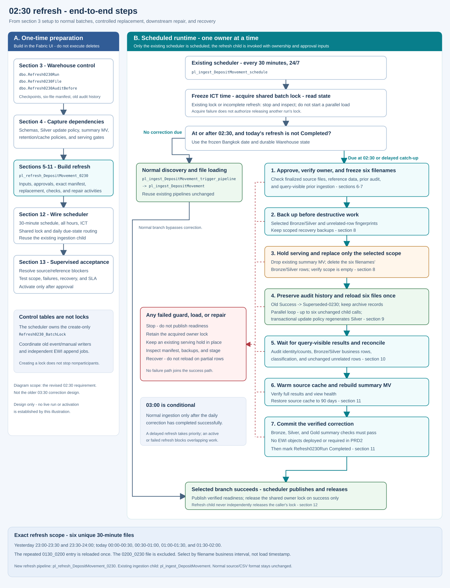
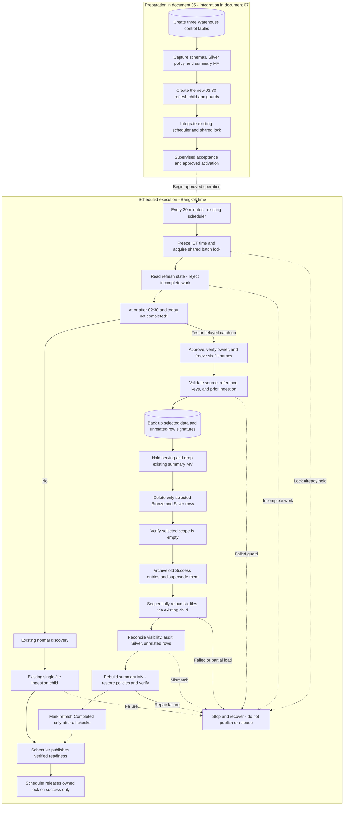
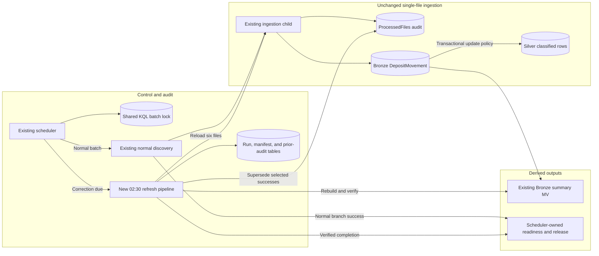

# Create `pl_refresh_DepositMovement_0230` - Fabric UI Guide

**Read this document first.** Complete sections 1-12 to prepare the required objects and author the new refresh child. Then follow [07 - Modify the existing scheduler](../07-interval-scheduler/README.md) to connect the child, configure 24/7 scheduling, test, and activate. These are the two customer implementation documents; no separate controller or guide is required.

**Already building the pipeline?** Use the [build list](#main-canvas-build-list) below. Add its activities **one row at a time**. If your canvas already contains `Require Approval -> Freeze Date -> Set Backup Suffix -> Check Lock Owner -> Guard Lock Owner`, continue at **[Step 06 - Register Refresh](#step-06---register-refresh---script-nonquery)**. Do not recreate those five boxes, and do not add later guards before reaching their numbered step.

Create one new pipeline that replaces a specific set of previously ingested files at **02:30 Bangkok time**. Reuse the existing single-file ingestion pipeline for the reload, then return to normal ingestion on subsequent batches.

> **Documentation only:** This guide does not create, execute, or enable a live pipeline. These revised 02:30 instructions have not been tested end-to-end in Fabric. The earlier [live test report](../TEST-RESULTS.md) concerns a different refresh design and must not be presented as validation of this one.
>
> **File-list assumption:** The request repeated `0130_0200`. This guide reloads the **six unique files** listed below, once each. It does **not** include `0200_0230`. Confirm this selection before production activation.

> **Target:** [RTI-IDM-PRD2 / DepositMovement](https://app.fabric.microsoft.com/groups/e450f2e3-d905-4264-bbdc-48f662460504/databases/dee83b58-0ec4-4cd8-8452-6a6a57ef6ac9/tables/Tables?experience=fabric-developer&autoRun=false). This guide uses the existing Bronze, Silver, holiday/window references, classification function, and **one Gold summary MV**. It does not create an alerting/EWI layer.

## 1. Requirement and pipeline responsibilities

For refresh date **2026-11-20**, replace only:

```text
INTRADAY_SUMMARY_20261119_2300_2330.CSV
INTRADAY_SUMMARY_20261119_2330_2400.CSV
INTRADAY_SUMMARY_20261120_0000_0030.CSV
INTRADAY_SUMMARY_20261120_0030_0100.CSV
INTRADAY_SUMMARY_20261120_0100_0130.CSV
INTRADAY_SUMMARY_20261120_0130_0200.CSV
```

The date in each filename is the interval's calendar date. `2400` means midnight at the end of the previous date.

| Pipeline | Responsibility |
| --- | --- |
| `pl_ingest_DepositMovement_schedule` | Existing 30-minute, 24/7 entry point; coordinate a shared batch lock and route the due refresh versus normal discovery |
| **`pl_refresh_DepositMovement_0230`** | New pipeline described here: validate six files, back up, delete their old rows, supersede audit successes, reload, and repair/verify derived results |
| `pl_ingest_DepositMovement_trigger_pipeline` | Existing normal discovery; reuse unchanged |
| `pl_ingest_DepositMovement` | Existing one-file ingestion child; reuse unchanged |

```text
Scheduler - every 30 minutes, 24/7
  -> acquire shared batch lock
  -> check incomplete/due refresh
       -> due: new 02:30 refresh pipeline
       -> otherwise: existing normal discovery
  -> publish verified results
  -> release shared batch lock
```

**03:00 is a normal batch only if the refresh has finished successfully.** If the refresh fails or runs past 03:00, do not overlap normal ingestion with the replacement. Alert and recover, or allow the next eligible batch after recovery.


## 2. Prerequisites and stop conditions

Before enabling any destructive activity:

1. Open **RTI-IDM-PRD2 > pl_ingest_DepositMovement_schedule > Schedule**, record its current configuration, turn scheduled starts **Off**, and save. Retain the current pipeline definition/settings through the approved backup process. Keep the schedule disabled until document 07 is completed.
2. Verify the [existing single-file ingestion pipeline](../../05-data-pipeline/README.md) works with the production source connection.
3. Confirm all six source files are present and **finalized/immutable during the refresh**. A size/last-modified check is an additional guard, not a producer finalization guarantee.
4. Confirm whether the selected files really contain 30-minute intervals; do not silently substitute the older 15-minute feed.
5. Coordinate all writers: event triggers, manual ingestion, and other schedules must not write during replacement. The unchanged ingestion child does not acquire the new shared lock by itself.
6. Drain already-submitted ingestion before deletion, including queued ingestion. A stable row count alone does not establish that the queue is empty.
7. Retain the current schemas, update policy, existing MV definition/policies, and recovery backups.
8. Coordinate dashboard/Activator maintenance. Deleting source rows does not automatically retract Silver rows or materialized sums; full MV rebuilding can temporarily make those views unavailable.
9. Verify the existing holiday/window reference uniqueness and calendar coverage, and test the approved source connection in the target workspace. Do not treat results from a different workspace as proof of this deployment's readiness.
10. Obtain permissions for Warehouse DDL/DML, source reads, KQL scoped deletion, and MV reconstruction.

The output inventory must match the target database: repair Silver classification and the original Gold summary MV. Stop for review if additional dependencies are found; do not create missing layers to imitate another deployment.

**Do not use a Bronze-only delete/reload in this deployment.** Existing Silver would otherwise retain old rows, and the Gold summary could report stale or duplicated results.

## 3. Prepare the new Warehouse control tables

### End-to-end overview - from preparation to the next normal batch

The left lane is **one-time setup** beginning with these Warehouse tables. The right lane is **scheduled execution** after acceptance and approved activation.



[Open the full-size diagram](END-TO-END-0230.svg).

| Phase | What happens | Detailed steps |
| --- | --- | --- |
| Prepare | Create the three control tables, capture dependencies/policies, and author the new child | Sections 3-7 |
| Integrate and approve | Wire the existing scheduler, coordinate writers/consumers, and complete supervised acceptance | Document 07 |
| Route each batch | Freeze ICT time, acquire the shared lock, and check incomplete/due refresh state | Document 07 |
| Normal branch | Invoke existing discovery and the unchanged single-file ingestion child | Document 07 |
| Refresh branch | Validate exactly six files and prior ingestion; back up; hold serving; replace selected Bronze/Silver rows; preserve audit; reload each file once | Sections 6-10 |
| Repair and verify | Rebuild the existing summary MV, restore its policies, reconcile, then mark complete | Section 11 |
| Finish | The scheduler publishes readiness and releases its lock only after its selected branch succeeds | Document 07 |
| Failure | Retain any acquired owner lock, do not publish readiness, and recover the original scope before resuming | Section 13 |

**Reading the diagram:**

- `Refresh0230Run` stores the run/checkpoint; `Refresh0230File` stores the six-file manifest and source/reload identities; `Refresh0230AuditBefore` preserves prior audit successes.
- Those SQL tables are **not locks**. `Refresh0230_BatchLock` is the create-only KQL ownership object; other entry points must participate or be coordinated.
- The due branch normally runs at **02:30 ICT**. A delayed/missed correction has priority over ordinary ingestion; **03:00 is normal only after correction succeeds**.
- Source replacement is limited to the six filename-selected files. The Gold summary is rebuilt from corrected Bronze after Silver reconciliation.
- If lock acquisition fails, do not release another run's lock. After ownership is acquired, later failures retain that lock and any serving hold already applied.
- This is a **design illustration**, not evidence that a pipeline has been deployed or run.

<details>
<summary>Editable Mermaid source - overall setup and execution</summary>

<!-- mermaid-checked: no \n, no em-dash/en-dash, no {} in labels, subgraphs are id["label"], arrows are -->|"label"|, all subgraphs closed by end, ids unique -->


</details>

<details>
<summary>Component relationships - control, existing ingestion, and data layers</summary>

<!-- mermaid-checked: no \n, no em-dash/en-dash, no {} in labels, subgraphs are id["label"], arrows are -->|"label"|, all subgraphs closed by end, ids unique -->


The summary MV reads Bronze, while the transactional policy regenerates Silver. The caller publishes readiness only after its selected branch finishes successfully.

</details>

### Why add these tables instead of using only `ProcessedFiles`?

The existing `dbo.ProcessedFiles` answers **"Was this filename successfully loaded?"** It does not record whether the whole six-file correction, including Silver verification and Gold-summary repair, completed successfully.

The three new tables add durable refresh-level tracking in the **same existing Warehouse**. They do not replace `ProcessedFiles` or require a schema change to the unchanged ingestion child.

| Table | Responsibility | Used by |
| --- | --- | --- |
| Existing `dbo.ProcessedFiles` | Per-file ingestion outcomes and the normal `Status='Success'` duplicate check | Existing discovery/ingestion and the new refresh |
| New `dbo.Refresh0230Run` | Refresh date, owner/run identity, backup suffix, overall status, and stage; determines whether correction completed or must block normal ingestion | Refresh and scheduler |
| New `dbo.Refresh0230File` | Exact six-file manifest, source size/modification time, replacement row counts, and replacement child run IDs | Refresh selection, reload, and verification |
| New `dbo.Refresh0230AuditBefore` | Snapshot of the selected original Success audit entries, associated with the refresh that superseded them | Audit traceability and controlled rollback |

These tables are **required by this six-file refresh workflow**, although an ordinary Copy activity does not require them. Create all three as documented: the later refresh, scheduler, and recovery checks depend on them.

### How the new tables work together with normal `ProcessedFiles`

The pipeline explicitly reads and updates the tables. There is **no automatic synchronization or database trigger** between them:

- `FileName` connects a manifest file to its old and new ingestion audit entries.
- `Refresh0230File.RunId` associates the manifest with `Refresh0230Run.RunId`.
- `Refresh0230AuditBefore.RefreshRunId` associates the original audit snapshot with that refresh.
- `Refresh0230File.ReloadPipelineRunId` identifies the replacement ingestion child run, not the overall refresh run.

For example, consider `INTRADAY_SUMMARY_20261120_0000_0030.CSV`:

1. **Normal ingestion:** the existing child loads the file and inserts a `Success` entry into `ProcessedFiles`. Subsequent normal batches skip it.
2. **Register the correction:** the refresh inserts a `Running` entry into `Refresh0230Run` and freezes its six filenames in `Refresh0230File`. It reads the matching prior successes from `ProcessedFiles`, validates source/prior ingestion, and backs up the selected data.
3. **Make only the selected files eligible for replacement:** after the selected Bronze/Silver rows are deleted and the empty scope is verified, `Supersede Audit` copies their original Success entries to `Refresh0230AuditBefore` and changes those entries in `ProcessedFiles` to `Superseded-0230`, in the same SQL transaction. Unrelated audit entries are untouched.
4. **Reload using the unchanged child:** its duplicate check still looks for `Status='Success'`. The old entry is now Superseded, so it no longer blocks the reload. On a successful load, the child inserts a **new Success entry** into `ProcessedFiles`; it does not overwrite the old audit row.
5. **Verify the complete correction:** the refresh requires exactly one current Success per selected filename, validates its time/count/run identity, and records the replacement row count and child run ID in `Refresh0230File`. Only after all source and derived-output checks pass does it mark `Refresh0230Run` as `Completed`.
6. **Return to normal batches:** the scheduler can resume ordinary discovery. Its normal duplicate checks see the new Success entries, so the six refreshed files are skipped again while genuinely new files remain eligible.

The audit lifecycle for that one filename is:

| Point in processing | Original audit row in `ProcessedFiles` | Replacement audit row in `ProcessedFiles` | Overall refresh |
| --- | --- | --- | --- |
| Before correction | `Success`, original child run ID | None | Not yet started |
| After scoped deletion and audit superseding | `Superseded-0230`, original child run ID | None | `Running` |
| After that file reloads successfully | `Superseded-0230`, original child run ID | `Success`, new child run ID | Still `Running` until every check passes |
| After all six files and derived outputs reconcile | Preserved as `Superseded-0230` | New `Success` retained | `Completed` |

The original Success values are also retained in `Refresh0230AuditBefore`; no audit history is deleted merely to bypass duplicate protection. The detailed SQL and child invocation are in [section 9](#9-preserve-the-audit-and-reload-through-the-existing-child).

### Why a file Success is not a completed refresh

Suppose three of the six files reload successfully and the fourth fails. `ProcessedFiles` may already contain three new Success entries, but **the overall refresh is still incomplete**. The scheduler checks `Refresh0230Run`, retains the acquired shared lock on failure, and must not resume normal processing until recovery is completed.

Use the frozen manifest, source metadata, backup suffix, original audit snapshot, and replacement child run IDs to investigate. Do not blindly reload successful files again, delete the checkpoint, or clear `ProcessedFiles` to force a retry.

These tables support durable tracking and controlled recovery; they are **not mutexes** and do **not** provide automatic rollback across Warehouse, KQL, and file ingestion. The shared KQL batch lock and coordination of other writers are still required.

### Create the tables in the Fabric Warehouse editor

In Fabric, open **RTI-IDM-PRD2 > wh_control_framework > New SQL query**. Verify the Warehouse belongs to this workspace, then run the following once.

These are separate tables for this requirement. Do not delete or change the schema of `dbo.ProcessedFiles`.

```sql
IF OBJECT_ID('dbo.Refresh0230Run','U') IS NULL
CREATE TABLE dbo.Refresh0230Run (
    RunId VARCHAR(64) NOT NULL,
    RefreshDate DATE NOT NULL,
    BackupSuffix VARCHAR(64) NOT NULL,
    Status VARCHAR(20) NOT NULL,
    Stage VARCHAR(40) NOT NULL,
    StartedAtUtc DATETIME2(3) NOT NULL,
    CompletedAtUtc DATETIME2(3) NULL
);

IF OBJECT_ID('dbo.Refresh0230File','U') IS NULL
CREATE TABLE dbo.Refresh0230File (
    RunId VARCHAR(64) NOT NULL,
    FileName VARCHAR(260) NOT NULL,
    SourceBytes BIGINT NULL,
    SourceLastModified DATETIME2(6) NULL,
    ReloadRows BIGINT NULL,
    ReloadPipelineRunId VARCHAR(64) NULL
);

IF OBJECT_ID('dbo.Refresh0230AuditBefore','U') IS NULL
CREATE TABLE dbo.Refresh0230AuditBefore (
    RefreshRunId VARCHAR(64) NOT NULL,
    FileName VARCHAR(260) NOT NULL,
    IngestedAtUtc DATETIME2(3) NOT NULL,
    RowCount_ BIGINT NOT NULL,
    Status VARCHAR(32) NOT NULL,
    PipelineName VARCHAR(200) NULL,
    PipelineRunId VARCHAR(64) NULL,
    RunAsUser VARCHAR(200) NULL,
    ErrorMsg VARCHAR(4000) NULL
);
```

Refresh the Warehouse explorer and verify all three tables. These tables are **not mutexes**; exclusivity comes from the shared KQL batch lock configured in document 07.

## 4. Capture the KQL dependencies before authoring

Open a **KQL Queryset** connected to **eh-rti-deposit > DepositMovement**.

Run each command separately and retain its full result:

```kql
.show table DepositMovementClassified policy update
```

```kql
.show materialized-views
| where SourceTable in ("DepositMovement","DepositMovementClassified")
| project Name,SourceTable,Query,Folder,DocString,IsEnabled,AutoUpdateSchema,Lookback
```

For each returned MV, capture its explicit retention and caching policies. The inspected PRD2 database returned **only** `mv_Summary_Product_Channel_Alert`, so run these two commands:

```kql
.show materialized-view mv_Summary_Product_Channel_Alert policy retention
```

```kql
.show materialized-view mv_Summary_Product_Channel_Alert policy caching
```

The inventory must contain the existing `mv_Summary_Product_Channel_Alert` sourced from `DepositMovement`. Retain its complete query and policy values, not a truncated grid cell. This guide expects its reviewed definition shown in section 11; stop for review if the customer's definition, explicit policies, or dependency inventory differ.

Next create the two new serving-support objects below. They use only the existing Bronze table.

### Create the core serving objects in the Fabric UI

These are **new CR support objects**, not objects the customer is expected to already have. The existing summary MV is not renamed or replaced by this setup step.

1. In the target KQL database's Queryset editor, paste and run this command by itself:

   ```kql
   .create-merge table CR01_PublishState (
       IsReady:bool,
       ChangedAtUtc:datetime,
       Owner:string
   )
   with (folder="CR01")
   ```

2. Then paste and run this complete function command by itself:

   ```kql
   .create-or-alter function with (folder="CR01")
   CR01_Summary_Product_Channel_Alert()
   {
       let ready=toscalar(
           CR01_PublishState
           | top 1 by ChangedAtUtc desc
           | project IsReady);
       DepositMovement
       | where ready==true
       | summarize
           Time=max(Time),
           Credit_Amount=sum(Credit_Amount),
           Debit_Amount=sum(Debit_Amount),
           Net_Amount=sum(Net_Amount),
           Credit_Transaction=sum(Credit_Transaction),
           Debit_Transaction=sum(Debit_Transaction),
           Total_Transaction=sum(Total_Transaction),
           UpdatedAtUtc=max(load_ts)
           by Date,Product,Channel,Channel_Group
   }
   ```

3. Refresh the database explorer and confirm the new readiness table and summary function exist.
4. Run `CR01_Summary_Product_Channel_Alert() | summarize Rows=count()`. Before the scheduler publishes readiness, expect zero rows. Do not insert readiness=true to make this setup check return data.
5. Coordinate the actual report/alert source change or pause consumers under the approved maintenance procedure. Creating the function does not rewire any existing consumer.
6. Do not create a lock or date-specific backups here. Runtime activities manage those objects.

## 5. Create the new pipeline and inputs

1. In **RTI-IDM-PRD2**, select **New item > Data pipeline**.
2. Name it **`pl_refresh_DepositMovement_0230`**.
3. Select the blank canvas and add these parameters:

   | Parameter | Type | Default / source |
   | --- | --- | --- |
   | `pRefreshDate` | String | Empty; caller supplies the ICT correction date or the pipeline uses today |
   | `pLockOwner` | String | Empty; caller must pass the owning scheduler run ID |
   | `pMaintenanceApproved` | Boolean | `false` |
   | `pSourceFinalized` | Boolean | `false` |

4. Add String variables `vRefreshDate`, `vBackupSuffix`, and `vKqlFileList`.
5. Save. **Do not add an independent schedule to this pipeline.**

### Common activity settings - use these throughout sections 6-11

An **activity type** is the kind of step selected from Fabric's activity menu, such as **If condition**, **Set variable**, or **KQL**. An **activity name** is the name you assign to that step on the canvas.

Each instruction heading gives both:

```text
Step 01 - Require Approval - If condition
    ----------------   ------------
    Name to enter      Activity type to select in Fabric
```

For this example, select **If condition** in Fabric, then rename the new box **Require Approval**. Search the activity menu for the type `If condition`, not for the custom name `Require Approval`.

#### How to add an activity

1. Open **`pl_refresh_DepositMovement_0230`** in the Fabric pipeline editor.
2. Select **Activities** on the top toolbar.
3. Open the activity list/picker and find the **type** from the heading. Use its search box to find the type, or expand the activity menu if it is not immediately visible.
4. Select that type to add a new activity box to the current canvas.
5. Select the new box, open **General**, and change **Name** to the exact name from the heading.
6. Open its **Settings** or **Activities** tab as directed in that section and enter the supplied values/expressions.
7. For the main sequence, connect the preceding activity's green **On success** output to the new activity. Do not use On completion.
8. Select **Save**. Do not run the pipeline while authoring it.

For activities inside a loop or branch, open that loop/branch canvas **before** adding them. Otherwise Fabric adds the box to the wrong level.

#### Which type should I select?

| Select this type in Activities | Example name to enter under General > Name | Purpose |
| --- | --- | --- |
| **If condition** | `Require Approval`, `Guard Lock Owner` | Evaluate a Boolean expression and choose True/False |
| **Set variable** | `Freeze Date`, `Set Backup Suffix` | Assign a value to a pipeline variable |
| **KQL** | `Check Lock Owner`, `Backup Bronze` | Execute a KQL command in `DepositMovement` |
| **Script** | `Register Refresh`, `Supersede Audit` | Execute the supplied SQL in `wh_control_framework` |
| **Lookup** | `Read Manifest`, `Read Reload Audit` | Read SQL results for later activities |
| **ForEach** | `Check Source Files`, `Reload Selected Files` | Run inner activities once for each selected file |
| **Get Metadata** | `Read Source Metadata`, `Recheck Source Metadata` | Read source-file existence, size, or modification time |
| **Until** | `Wait For Prior Ingestion`, `Wait For Healthy Views` | Repeat inner activities until the exit expression is true |
| **Wait** | `Wait Prior Visibility`, `Wait View Health` | Pause for the specified number of seconds inside a loop |
| **Invoke pipeline** | `Invoke File Reload` | Call the existing single-file ingestion pipeline |
| **Fail** | `Require Approval Failed` | Stop a branch with the supplied error code/message |

Use the table only to identify menu labels. Follow **Step 01 through Step 36** below to build the main canvas. Activities inside a branch/loop are explicitly marked with their location.

#### Settings to apply to the new activities

| UI setting | Value for new activities |
| --- | --- |
| General > Retry | `0` |
| General > Timeout | `0.02:00:00` |
| KQL > Database | Existing `DepositMovement` in the target workspace |
| KQL > Command timeout | `01:00:00` |
| Script / Lookup > Connection | Existing `wh_control_framework` |
| Script > Script type | `NonQuery` |
| Script block execution timeout / Lookup query timeout | `01:00:00` |
| Get Metadata > Connection | Approved ADLS Gen2 source connection |
| Until > Timeout | `0.00:30:00` |
| Wait > Seconds | `5` |

A timeout is a failure, not permission to continue. Confirm these limits accommodate the approved data volume before activation.

- Paste SQL/KQL containing `@{...}` with **Add dynamic content**. Paste the displayed text, not a JSON `value`/`type` wrapper.
- Names below are exact because expressions refer to them.
- Unless a specific code is given, each verification If condition uses a **Fail** activity in True with error code `R0230_VERIFY` and a message naming the failed check; False is empty. Continue only on the If condition's success output.
- Click the pencil/open-canvas control on ForEach or Until to add its inner activities. Add If-condition Fail activities inside the **True** branch, not on the main canvas.

### Main-canvas build list

This table lists the boxes on the **main canvas**. A row is not an instruction to create all later boxes now. Finish the matching numbered step, save, then move to the next row.

| Step | Type to select in Activities | Name to enter in General | Connect On success from |
| --- | --- | --- | --- |
| 01 | If condition | `Require Approval` | None - first box |
| 02 | Set variable | `Freeze Date` | `Require Approval` |
| 03 | Set variable | `Set Backup Suffix` | `Freeze Date` |
| 04 | KQL | `Check Lock Owner` | `Set Backup Suffix` |
| 05 | If condition | `Guard Lock Owner` | `Check Lock Owner` |
| 06 | Script | `Register Refresh` | `Guard Lock Owner` |
| 07 | Lookup | `Read Manifest` | `Register Refresh` |
| 08 | If condition | `Guard Manifest Count` | `Read Manifest` |
| 09 | Lookup | `Read Delete Predicate` | `Guard Manifest Count` |
| 10 | Set variable | `Set Delete Predicate` | `Read Delete Predicate` |
| 11 | ForEach | `Check Source Files` | `Set Delete Predicate` |
| 12 | Lookup | `Read Prior Audit` | `Check Source Files` |
| 13 | Until | `Wait For Prior Ingestion` | `Read Prior Audit` |
| 14 | KQL | `Backup Bronze` | `Wait For Prior Ingestion` |
| 15 | KQL | `Backup Silver` | `Backup Bronze` |
| 16 | KQL | `Snapshot Unrelated Rows` | `Backup Silver` |
| 17 | KQL | `Hold Serving` | `Snapshot Unrelated Rows` |
| 18 | KQL | `Drop Gold Summary` | `Hold Serving` |
| 19 | KQL | `Delete Selected Bronze` | `Drop Gold Summary` |
| 20 | KQL | `Delete Selected Silver` | `Delete Selected Bronze` |
| 21 | KQL | `Check Empty Scope` | `Delete Selected Silver` |
| 22 | If condition | `Guard Empty Scope` | `Check Empty Scope` |
| 23 | Script | `Supersede Audit` | `Guard Empty Scope` |
| 24 | ForEach | `Reload Selected Files` | `Supersede Audit` |
| 25 | Script | `Capture Reload Audit` | `Reload Selected Files` |
| 26 | Lookup | `Read Reload Audit` | `Capture Reload Audit` |
| 27 | Until | `Wait For Queryable Reload` | `Read Reload Audit` |
| 28 | KQL | `Check Reload Consistency` | `Wait For Queryable Reload` |
| 29 | If condition | `Guard Reload Consistency` | `Check Reload Consistency` |
| 30 | KQL | `Check Unrelated Rows` | `Guard Reload Consistency` |
| 31 | If condition | `Guard Unrelated Rows` | `Check Unrelated Rows` |
| 32 | KQL | `Rebuild Gold Summary` | `Guard Unrelated Rows` |
| 33 | Until | `Wait For Healthy Views` | `Rebuild Gold Summary` |
| 34 | KQL | `Check Gold Summary Values` | `Wait For Healthy Views` |
| 35 | If condition | `Guard Gold Summary Values` | `Check Gold Summary Values` |
| 36 | Script | `Mark Refresh Completed` | `Guard Gold Summary Values` |

Names starting with `Guard` are **If condition** activities. Their True branch contains a Fail activity. The detailed steps provide each exact expression, Fail name, error code, and message. Do not invent a name or substitute a placeholder.

## 6. Author approval, date, ownership, and manifest activities

Work through sections 6-11 in order on **`pl_refresh_DepositMovement_0230`**. If you already added an activity while following this guide, select and configure that existing box instead of creating a duplicate. Select **Save**, not Run, at each authoring checkpoint.

### Step 01 - `Require Approval` - If condition

1. On the refresh pipeline's **main canvas**, select **Activities**.
2. Find and select **If condition**. Fabric adds a new If-condition box.
3. Select that box and open **General**.
4. Set **Name** to **`Require Approval`**.
5. Open its **Activities** tab and select **Expression > Add dynamic content**.
6. Paste:

```text
@not(and(pipeline().parameters.pMaintenanceApproved,pipeline().parameters.pSourceFinalized))
```

7. Select **OK** to apply the expression.
8. Open the **True** branch using its edit/pencil control.
9. Inside that branch, select **Activities > Fail** and configure:

   | Field | Value |
   | --- | --- |
   | General > Name | `Require Approval Failed` |
   | Settings > Error code | `R0230_NOT_APPROVED` |
   | Settings > Message | `Refresh requires approved maintenance and finalized source files.` |

10. Leave the **False** branch empty.
11. Return to the main canvas using the breadcrumb/back control and **Save**.
12. Continue to Step 02. Do not add other main-canvas activities yet.

The expression is true when either approval flag is false, so **True intentionally stops the pipeline**. Both flags must be true for this check to succeed. They record an operational precondition; they do not stop another writer by themselves.

### Step 02 - `Freeze Date` - Set variable

1. Return to the **main canvas**.
2. Select **Activities > Set variable**.
3. Select the new box > **General > Name** and enter `Freeze Date`.
4. Connect `Require Approval` **On success** to `Freeze Date`.
5. Open **Settings > Variable** and select `vRefreshDate`.
6. Select **Value > Add dynamic content** and paste:

```text
@formatDateTime(if(empty(pipeline().parameters.pRefreshDate),convertFromUtc(utcNow(),'SE Asia Standard Time'),pipeline().parameters.pRefreshDate),'yyyy-MM-dd')
```

This normalizes the date before interpolating it into SQL/KQL. Do not use the unvalidated parameter directly in a delete.

7. Select **OK**, then **Save**.

### Step 03 - `Set Backup Suffix` - Set variable

1. On the main canvas, select **Activities > Set variable**.
2. Set **General > Name** to `Set Backup Suffix`.
3. Connect `Freeze Date` **On success** to it.
4. Open **Settings > Variable** and select `vBackupSuffix`.
5. Select **Value > Add dynamic content** and paste:

```text
@concat(formatDateTime(variables('vRefreshDate'),'yyyyMMdd'),'_',replace(pipeline().RunId,'-',''))
```

Keep this suffix in the run record. Backup/staging names must not change during recovery.

6. Select **OK**, then **Save**.

### Step 04 - `Check Lock Owner` - KQL

The scheduler must already hold `Refresh0230_BatchLock`. A missing lock table is a failure.

1. On the main canvas, select **Activities > KQL**.
2. Set **General > Name** to `Check Lock Owner`, **Retry** to `0`, and **Timeout** to `0.02:00:00`.
3. Connect `Set Backup Suffix` **On success** to it.
4. Open **Settings**, select the existing workspace **KQL Database > DepositMovement**, and set Command timeout to `01:00:00`.
5. Select **Command > Add dynamic content** and paste the complete command:

```kql
.set-or-replace Refresh0230_Checks <|
    let Owners=toscalar(
        Refresh0230_BatchLock
        | summarize Rows=count(),
            Matching=countif(Owner=="@{pipeline().parameters.pLockOwner}")
        | project Valid=Rows==1 and Matching==1);
    print Problem="Refresh does not own the scheduler batch lock"
    | where Owners!=true
```

6. Select **OK**, then **Save**.

### Step 05 - `Guard Lock Owner` - If condition

1. On the main canvas, select **Activities > If condition**.
2. Set **General > Name** to `Guard Lock Owner`.
3. Connect `Check Lock Owner` **On success** to this box.
4. Open **Activities > Expression > Add dynamic content** and paste:

```text
@greater(int(activity('Check Lock Owner').output.count),0)
```

5. Select **OK**, then open this box's **True** branch.
6. Add **Activities > Fail** and set **General > Name** to `Guard Lock Owner Failed`.
7. Open the Fail activity's **Settings**; set Error code to `R0230_LOCK` and Message to `Refresh does not own the scheduler batch lock.`
8. Leave **False** empty. Return to the main canvas and **Save**.

**Next: continue directly to Step 06 - Register Refresh**, type **Script**. Connect it to the green **On success** output on the right of `Guard Lock Owner`. Do not create the later guards now.

### Step 06 - `Register Refresh` - Script, NonQuery

**Enter SQL in the Script block, not in the pipeline expression builder.** This activity uses three bound Script input parameters. The SQL stays plain text; only the parameter values use pipeline expressions.

1. If the **Pipeline expression builder** is open for the entire SQL statement, select **Cancel** to close it without applying that mixed SQL/expression text.
2. Select the existing `Register Refresh` activity. If it has not been added, select **Activities > Script** once.
3. Set **General > Name** to `Register Refresh`, **Retry** to `0`, and **Timeout** to `0.02:00:00`.
4. Confirm `Guard Lock Owner` **On success** connects to it.
5. Open **Settings > Connection** and select the existing Warehouse `wh_control_framework` in **RTI-IDM-PRD2**.
6. Keep one script block and select **NonQuery**. Remove an accidentally added empty block.
7. Click directly in that block's **SQL/script text field**. Replace its text with the complete SQL below. **Do not select Add dynamic content for this SQL text.**

```sql
DECLARE @d DATE=CONVERT(DATE,@RefreshDate,23);
DECLARE @run VARCHAR(64)=@RefreshRunId;
IF EXISTS(SELECT 1 FROM dbo.Refresh0230Run WHERE RefreshDate=@d)
    THROW 51300,'This date already has a refresh record. Inspect/recover it; do not start a second replacement.',1;

BEGIN TRANSACTION;
INSERT INTO dbo.Refresh0230Run
VALUES(@run,@d,@BackupSuffix,
       'Running','Preparing',SYSUTCDATETIME(),NULL);

INSERT INTO dbo.Refresh0230File(RunId,FileName)
SELECT @run,CONCAT('INTRADAY_SUMMARY_',
    CONVERT(CHAR(8),DATEADD(DAY,DayOffset,@d),112),'_',Slot,'.CSV')
FROM (VALUES
    (-1,'2300_2330'),
    (-1,'2330_2400'),
    ( 0,'0000_0030'),
    ( 0,'0030_0100'),
    ( 0,'0100_0130'),
    ( 0,'0130_0200')
) s(DayOffset,Slot);
COMMIT TRANSACTION;
```

8. Under **this script block**, expand **Parameters / Script parameters** and select **+ New** three times. This is **not** the pipeline canvas's Parameters tab.
9. Enter these exact parameter names **without `@`**. Set Type to **String** and Direction to **Input** for each row.

   | Script parameter Name | Type | Direction | Value - enter using Add dynamic content |
   | --- | --- | --- | --- |
   | `RefreshDate` | String | Input | `@variables('vRefreshDate')` |
   | `RefreshRunId` | String | Input | `@pipeline().RunId` |
   | `BackupSuffix` | String | Input | `@variables('vBackupSuffix')` |

10. For each parameter's **Value** cell, open **Add dynamic content**, paste only the expression from its row, and select **OK**. Do not surround the expression with SQL quotes.
11. Set **Script block execution timeout** to `01:00:00`.
12. Select **Home > Validate**. If an activity is invalid, expand its validation entry to identify the field; the generic "1 invalid activity" message does not identify a SQL syntax error.
13. When validation reports no invalid activity, select **Save**. **Do not select Run**: this SQL inserts the refresh checkpoint and six filenames.

`@RefreshDate`, `@RefreshRunId`, and `@BackupSuffix` in the SQL are input placeholders populated by the Script activity. `@d` and `@run` are SQL local variables. None of those names belongs in the pipeline expression builder as SQL text.

This changes how values are supplied, not the six-file selection or checkpoint rules. Continue to Step 07 only after the activity validates and saves.

### Step 07 - `Read Manifest` - Lookup

1. On the main canvas, select **Activities > Lookup**.
2. Set **General > Name** to `Read Manifest`, **Retry** to `0`, and **Timeout** to `0.02:00:00`.
3. Connect `Register Refresh` **On success** to it.
4. Open **Settings**, choose Warehouse `wh_control_framework`, and select **Use query > Query**.
5. Turn **First row only Off/Unchecked**.
6. Select the query editor > **Add dynamic content** and paste:

```sql
SELECT FileName
FROM dbo.Refresh0230File
WHERE RunId='@{pipeline().RunId}'
ORDER BY FileName;
```

7. Select **OK**, then **Save**.

### Step 08 - `Guard Manifest Count` - If condition

1. On the main canvas, select **Activities > If condition**.
2. Set **General > Name** to `Guard Manifest Count`.
3. Connect `Read Manifest` **On success** to it.
4. Open **Activities > Expression > Add dynamic content** and paste:

```text
@not(equals(int(activity('Read Manifest').output.count),6))
```

5. Select **OK**, open **True**, and add **Fail** named `Guard Manifest Count Failed`.
6. In Fail > **Settings**, set Error code `R0230_VERIFY` and Message `The refresh manifest must contain exactly six files.`
7. Leave **False** empty, return to the main canvas, and **Save**.

The output must contain exactly six distinct filenames. Keeping First row only off exposes the `count` and `value` properties used here and by the file loops.

### Step 09 - `Read Delete Predicate` - Lookup

1. On the main canvas, select **Activities > Lookup**.
2. Set **General > Name** to `Read Delete Predicate`, **Retry** to `0`, and **Timeout** to `0.02:00:00`.
3. Connect `Guard Manifest Count` **On success** to it.
4. Open **Settings**, choose Warehouse `wh_control_framework`, and select **Use query > Query**.
5. Turn **First row only On/Checked**.
6. Select the query editor > **Add dynamic content** and paste:

```sql
IF EXISTS(
    SELECT 1 FROM dbo.Refresh0230File
    WHERE RunId='@{pipeline().RunId}' AND FileName LIKE '%[^A-Z0-9_.]%'
)
    THROW 51301,'Unexpected filename characters in the manifest.',1;

SELECT STRING_AGG(CONCAT('"',FileName,'"'),',') AS KqlFileList
FROM dbo.Refresh0230File
WHERE RunId='@{pipeline().RunId}';
```

7. Select **OK**, then **Save**.

### Step 10 - `Set Delete Predicate` - Set variable

1. On the main canvas, select **Activities > Set variable**.
2. Set **General > Name** to `Set Delete Predicate`.
3. Connect `Read Delete Predicate` **On success** to it.
4. Open **Settings > Variable** and select `vKqlFileList`.
5. Select **Value > Add dynamic content** and paste:

```text
@activity('Read Delete Predicate').output.firstRow.KqlFileList
```

6. Select **OK**, then **Save**.
7. Check the main-canvas chain before continuing:

   ```text
   Require Approval -> Freeze Date -> Set Backup Suffix
     -> Check Lock Owner -> Guard Lock Owner -> Register Refresh
     -> Read Manifest -> Guard Manifest Count
     -> Read Delete Predicate -> Set Delete Predicate
   ```

Deletes use this literal, validated list. Do not select by `load_ts`, whole dates, a wildcard, or `file_name startswith` in a destructive command.

## 7. Check every source file before deleting anything

### Step 11 - `Check Source Files` - ForEach

1. On the **main canvas**, select **Activities > ForEach**.
2. Set **General > Name** to `Check Source Files`.
3. Connect `Set Delete Predicate` **On success** to this ForEach.
4. Open **Settings**, turn **Sequential On/Checked**, and select **Items > Add dynamic content**.
5. Paste:

```text
@activity('Read Manifest').output.value
```

6. Select **OK**. Open the ForEach's **Activities** canvas using its edit/pencil control.
7. Inside the loop, select **Activities > Get Metadata**.
8. Set **General > Name** to `Read Source Metadata`, **Retry** to `0`, and **Timeout** to `0.02:00:00`.
9. Open its **Settings** and configure:

   | Field | Value |
   | --- | --- |
   | Connection | Approved ADLS Gen2 connection |
   | Container | `inflowoutflow` |
   | Directory | `inbound/statement` |
   | File name | `@item().FileName` |
   | Field list | Add **Exists** (`exists`), **Size** (`size`), and **Last modified** (`lastModified`) |

   Enter the file name through **Add dynamic content**. This points at one manifest file, not the whole directory.

10. Still inside the ForEach, select **Activities > If condition** and name it `Require Source Exists`.
11. Connect `Read Source Metadata` **On success** to it.
12. Open **Activities > Expression > Add dynamic content** and paste:

   ```text
   @not(activity('Read Source Metadata').output.exists)
   ```

13. Select **OK**. Open **True** and add **Fail** named `Require Source Exists Failed`.
14. Set Error code `R0230_SOURCE_MISSING` and Message `A selected source file is missing; stop before deletion.` Leave **False** empty.
15. Return to the **Check Source Files inner canvas**, not the main pipeline.
16. Add **Activities > Script**, name it `Record Source Metadata`, and connect `Require Source Exists` **On success** to it.
17. In **Settings**, choose Warehouse `wh_control_framework`, add/select a **NonQuery** script block, and open **Add dynamic content**.
18. Paste:

   ```sql
   UPDATE dbo.Refresh0230File
   SET SourceBytes=@{activity('Read Source Metadata').output.size},
       SourceLastModified='@{formatDateTime(activity('Read Source Metadata').output.lastModified,'yyyy-MM-ddTHH:mm:ss.ffffff')}'
   WHERE RunId='@{pipeline().RunId}' AND FileName='@{item().FileName}';
   ```

19. Select **OK**. On `Record Source Metadata`, set **General > Retry** to `0`, **Timeout** to `0.02:00:00`, and **Settings > Script block execution timeout** to `01:00:00`. Select **Save**.
20. Verify the inner chain:

    ```text
    Read Source Metadata -> Require Source Exists -> Record Source Metadata
    ```

21. Return to the main canvas. The next main activity connects from the **ForEach box's On success**, not from an activity inside it.

A missing file/metadata error must stop the run before deletion. Retain the resulting run/checkpoint for explicit recovery rather than automatically dropping it and retrying.

This workflow requires finalized, immutable source files during replacement. If the producer cannot guarantee this, stop: do not activate this child-reuse procedure against mutable files.

On `Check Source Files` success, continue directly to `Read Prior Audit`.

### Step 12 - `Read Prior Audit` - Lookup

1. On the main canvas, select **Activities > Lookup**.
2. Set **General > Name** to `Read Prior Audit`.
3. Connect `Check Source Files` **On success** to it.
4. Open **Settings**, select Warehouse `wh_control_framework`, and choose **Use query > Query**.
5. Turn **First row only Off/Unchecked**.
6. Open the query editor > **Add dynamic content** and paste:

```sql
IF EXISTS(
    SELECT f.FileName FROM dbo.Refresh0230File f
    JOIN dbo.ProcessedFiles a ON a.FileName=f.FileName AND a.Status='Success'
    WHERE f.RunId='@{pipeline().RunId}'
    GROUP BY f.FileName HAVING COUNT(*)>1
)
    THROW 51308,'Multiple prior successes need reconciliation before replacement.',1;

SELECT f.FileName,COALESCE(SUM(a.RowCount_),0) AS ExpectedRows
FROM dbo.Refresh0230File f
LEFT JOIN dbo.ProcessedFiles a ON a.FileName=f.FileName AND a.Status='Success'
WHERE f.RunId='@{pipeline().RunId}'
GROUP BY f.FileName
ORDER BY f.FileName;
```

7. Select **OK**. On `Read Prior Audit`, set **General > Retry** to `0`, **Timeout** to `0.02:00:00`, and **Settings > Query timeout** to `01:00:00`. Select **Save**.

### Step 13 - `Wait For Prior Ingestion` - Until

1. On the main canvas, select **Activities > Until**.
2. Set **General > Name** to `Wait For Prior Ingestion`.
3. Connect `Read Prior Audit` **On success** to it.
4. Open the Until's **Activities** canvas using its edit/pencil control.
5. Inside it, add **Activities > KQL** and name it `Check Prior Visibility`.
6. Open **Settings**, choose the existing `DepositMovement` KQL database, and set Command timeout to `01:00:00`.
7. Open **Command > Add dynamic content** and paste:

```kql
.set-or-replace Refresh0230_Checks <|
    let expected=
        print items=parse_json(base64_decode_tostring("@{base64(string(activity('Read Prior Audit').output.value))}"))
        | mv-expand items
        | project file_name=tostring(items.FileName),Expected=tolong(items.ExpectedRows);
    union
        (expected | join kind=leftouter (
            DepositMovement | where file_name in (@{variables('vKqlFileList')})
            | summarize Actual=count() by file_name
          ) on file_name
         | where Expected!=coalesce(Actual,0)
         | project Problem=strcat("Prior Bronze/audit mismatch: ",file_name)),
        (expected | join kind=leftouter (
            DepositMovementClassified | where file_name in (@{variables('vKqlFileList')})
            | summarize Actual=count() by file_name
          ) on file_name
         | where Expected!=coalesce(Actual,0)
         | project Problem=strcat("Prior Silver/audit mismatch: ",file_name))
```

8. Select **OK**. On `Check Prior Visibility`, set **General > Retry** to `0` and **Timeout** to `0.02:00:00`.
9. Still inside Until, add **Activities > Wait** and name it `Wait Prior Visibility`.
10. Connect `Check Prior Visibility` **On success** to the Wait activity.
11. Open **Wait > Settings** and set **Wait time in seconds** to `5`.
12. Return to the main canvas, select the **Wait For Prior Ingestion** Until box, and open its **Settings / Expression** control.
13. Use **Add dynamic content** for the exit expression:

```text
@equals(int(activity('Check Prior Visibility').output.count),0)
```

14. Select **OK** and set the Until **Timeout** to `0.00:30:00`.
15. **Save** and verify its inner canvas contains only `Check Prior Visibility -> Wait Prior Visibility`.
16. Continue to section 8 from the **Until box's On success** output.

Timeout: 30 minutes. This catches selected rows still awaiting ingestion or rows without a matching audit. It supplements, but does not replace, operational draining and exclusion of other writers.

## 8. Back up, hold serving, and delete the selected records

**Author these activities without running them.** The delete/drop commands execute only during the approved complete scheduler run, after the earlier guards have passed.

### Step 14 - `Backup Bronze` - KQL

1. On the main canvas, select **Activities > KQL**.
2. Set **General > Name** to `Backup Bronze`, **Retry** to `0`, and **Timeout** to `0.02:00:00`.
3. Connect `Wait For Prior Ingestion` **On success** to it.
4. Open **Settings**, select `DepositMovement`, and set Command timeout to `01:00:00`.
5. Select **Command > Add dynamic content** and paste:

```kql
.set R0230_Bronze_@{variables('vBackupSuffix')} <|
    DepositMovement
    | where file_name in (@{variables('vKqlFileList')})
```

6. Select **OK**, then **Save**.

### Step 15 - `Backup Silver` - KQL

1. On the main canvas, select **Activities > KQL**.
2. Set **General > Name** to `Backup Silver`, **Retry** to `0`, and **Timeout** to `0.02:00:00`.
3. Connect `Backup Bronze` **On success** to it.
4. Open **Settings**, select `DepositMovement`, and set Command timeout to `01:00:00`.
5. Select **Command > Add dynamic content** and paste:

```kql
.set R0230_Silver_@{variables('vBackupSuffix')} <|
    DepositMovementClassified
    | where file_name in (@{variables('vKqlFileList')})
```

6. Select **OK**, then **Save**.

Use `.set`, not `.set-or-replace`, so a repeated attempt cannot overwrite the original backups. Keep their retention/recovery lifetime appropriate to the approved rollback period.

The preceding audit/visibility checks must pass. If queued data remains, stop and investigate rather than assuming a Copy-success audit establishes quiescence.

### Step 16 - `Snapshot Unrelated Rows` - KQL

1. On the main canvas, select **Activities > KQL**.
2. Set **General > Name** to `Snapshot Unrelated Rows`, **Retry** to `0`, and **Timeout** to `0.02:00:00`.
3. Connect `Backup Silver` **On success** to it.
4. Open **Settings**, select `DepositMovement`, and set Command timeout to `01:00:00`.
5. Select **Command > Add dynamic content** and paste:

```kql
.set R0230_Unrelated_@{variables('vBackupSuffix')} <|
    union
        (DepositMovement | extend Layer="Bronze"),
        (DepositMovementClassified | extend Layer="Silver")
    | where file_name !in (@{variables('vKqlFileList')})
    | summarize Copies=count() by Layer,Signature=tostring(pack_array(
        Date,Time,Product,Channel,Channel_Group,Credit_Amount,Debit_Amount,Net_Amount,
        Credit_Transaction,Debit_Transaction,Total_Transaction,
        load_ts,file_name,pipeline_name,pipeline_runid))
```

6. Select **OK**, then **Save**.

This records unrelated business/lineage multisets in both tables. Account for the full scan/storage cost in the production SLA.

### Step 17 - `Hold Serving` - KQL

1. On the main canvas, select **Activities > KQL**.
2. Set **General > Name** to `Hold Serving`, **Retry** to `0`, and **Timeout** to `0.02:00:00`.
3. Connect `Snapshot Unrelated Rows` **On success** to it.
4. Open **Settings**, select `DepositMovement`, and set Command timeout to `01:00:00`.
5. Select **Command > Add dynamic content** and paste:

```kql
.set-or-append CR01_PublishState <|
    print IsReady=false,ChangedAtUtc=now(),Owner="@{pipeline().parameters.pLockOwner}"
```

6. Select **OK**, then **Save**.

Before an approved run, affected consumers must actually use the serving gate or be paused; creating this activity alone does not rewire a report.

### Step 18 - `Drop Gold Summary` - KQL

Use the exact pre-reviewed dependency inventory. PRD2 requires **one** drop activity.

1. On the main canvas, select **Activities > KQL**.
2. Set **General > Name** to `Drop Gold Summary`, **Retry** to `0`, and **Timeout** to `0.02:00:00`.
3. Connect `Hold Serving` **On success** to it.
4. Open **Settings**, select `DepositMovement`, and set Command timeout to `01:00:00`.
5. In the plain **Command** editor, paste this literal command:

```kql
.drop materialized-view mv_Summary_Product_Channel_Alert
```

6. **Save**. Do not select Run to test this drop activity.

Do not treat deletion from the source as an automatic retraction of previously materialized sums. If additional dependants are found, update the approved repair procedure before proceeding.

First use the corresponding `.delete ... with (whatif=true)` commands during supervised validation and review their scope. The production activities below are destructive.

### Step 19 - `Delete Selected Bronze` - KQL

1. On the main canvas, select **Activities > KQL**.
2. Set **General > Name** to `Delete Selected Bronze`, **Retry** to `0`, and **Timeout** to `0.02:00:00`.
3. Connect `Drop Gold Summary` **On success** to it.
4. Open **Settings**, select `DepositMovement`, and set Command timeout to `01:00:00`.
5. Select **Command > Add dynamic content** and paste:

```kql
.delete table DepositMovement records <|
    DepositMovement
    | where file_name in (@{variables('vKqlFileList')})
```

6. Select **OK**, then **Save**.

### Step 20 - `Delete Selected Silver` - KQL

1. On the main canvas, select **Activities > KQL**.
2. Set **General > Name** to `Delete Selected Silver`, **Retry** to `0`, and **Timeout** to `0.02:00:00`.
3. Connect `Delete Selected Bronze` **On success** to it.
4. Open **Settings**, select `DepositMovement`, and set Command timeout to `01:00:00`.
5. Select **Command > Add dynamic content** and paste:

```kql
.delete table DepositMovementClassified records <|
    DepositMovementClassified
    | where file_name in (@{variables('vKqlFileList')})
```

6. Select **OK**, then **Save**.

Use literal filename predicates in these management commands. Do not insert `let`, `join`, or `mv-expand` into the delete query.

### Step 21 - `Check Empty Scope` - KQL

1. On the main canvas, select **Activities > KQL**.
2. Set **General > Name** to `Check Empty Scope`, **Retry** to `0`, and **Timeout** to `0.02:00:00`.
3. Connect `Delete Selected Silver` **On success** to it.
4. Open **Settings**, select `DepositMovement`, and set Command timeout to `01:00:00`.
5. Select **Command > Add dynamic content** and paste:

```kql
.set-or-replace Refresh0230_Checks <|
    union
        (DepositMovement | project file_name),
        (DepositMovementClassified | project file_name)
    | where file_name in (@{variables('vKqlFileList')})
    | project Problem=strcat("Selected rows remain: ",file_name)
```

6. Select **OK** to apply the command.

### Step 22 - `Guard Empty Scope` - If condition

1. On the main canvas, select **Activities > If condition**.
2. Set **General > Name** to `Guard Empty Scope`.
3. Connect `Check Empty Scope` **On success** to it.
4. Open **Activities > Expression > Add dynamic content** and enter `@greater(int(activity('Check Empty Scope').output.count),0)`.
5. Select **OK**, open **True**, and add **Fail** named `Guard Empty Scope Failed`.
6. Set Error code `R0230_VERIFY` and Message `Selected Bronze or Silver rows remain after deletion.`
7. Leave **False** empty, return to the main canvas, and **Save**.
8. Check the end of the chain: `Drop Gold Summary -> Delete Selected Bronze -> Delete Selected Silver -> Check Empty Scope -> Guard Empty Scope`.

Do not reset audit successes or reload until this guard passes during execution.

## 9. Preserve the audit and reload through the existing child

### Step 23 - `Supersede Audit` - Script, NonQuery

The original child checks `Status='Success'`. Re-running it without this step would skip previously loaded files.

1. On the main canvas, select **Activities > Script**.
2. Set **General > Name** to `Supersede Audit`, **Retry** to `0`, and **Timeout** to `0.02:00:00`.
3. Connect `Guard Empty Scope` **On success** to it.
4. Open **Settings > Connection** and select Warehouse `wh_control_framework`.
5. Add/select a **NonQuery** script block.
6. Open its text editor > **Add dynamic content** and paste:

```sql
BEGIN TRANSACTION;
INSERT INTO dbo.Refresh0230AuditBefore
SELECT '@{pipeline().RunId}',a.FileName,a.IngestedAtUtc,a.RowCount_,
       a.Status,a.PipelineName,a.PipelineRunId,a.RunAsUser,a.ErrorMsg
FROM dbo.ProcessedFiles a
JOIN dbo.Refresh0230File f ON f.FileName=a.FileName
WHERE f.RunId='@{pipeline().RunId}' AND a.Status='Success';

UPDATE a SET Status='Superseded-0230'
FROM dbo.ProcessedFiles a
JOIN dbo.Refresh0230File f ON f.FileName=a.FileName
WHERE f.RunId='@{pipeline().RunId}' AND a.Status='Success';

UPDATE dbo.Refresh0230Run SET Stage='Reloading'
WHERE RunId='@{pipeline().RunId}' AND Status='Running';
COMMIT TRANSACTION;
```

7. Select **OK**, then **Save**.

Preserve old audit entries; do not delete the whole control table or clear all today's/yesterday's success statuses.

### Step 24 - `Reload Selected Files` - ForEach

**This step creates five separate boxes inside one ForEach. Do not paste the SQL check into a Get Metadata field.**

| Inner box | Type to select | Name | Connect On success from |
| --- | --- | --- | --- |
| 24A | Get Metadata | `Recheck Source Metadata` | None inside this loop |
| 24B | Script | `Require Unchanged Source` | `Recheck Source Metadata` |
| 24C | Invoke pipeline | `Invoke File Reload` | `Require Unchanged Source` |
| 24D | Get Metadata | `Read Final Source Metadata` | `Invoke File Reload` |
| 24E | Script | `Require Final Source Unchanged` | `Read Final Source Metadata` |

1. On the main canvas, select **Activities > ForEach**.
2. Set **General > Name** to `Reload Selected Files`.
3. Connect `Supersede Audit` **On success** to it.
4. Open **Settings**, turn **Sequential On/Checked**, and set **Items > Add dynamic content** to `@activity('Read Manifest').output.value`.
5. Select **OK**, then open the ForEach's inner **Activities** canvas.
6. Add the following five inner activities in order. All five belong inside this ForEach, not on the main pipeline canvas.

Do not set per-file pipeline variables in a parallel loop. This workflow deliberately reloads the files sequentially.

#### Inside Step 24 - `Recheck Source Metadata` - Get Metadata

This is **box 24A**. Its File name expression is only `@item().FileName`. It has no SQL script.

1. Inside `Reload Selected Files`, select **Activities > Get Metadata**.
2. Set **General > Name** to `Recheck Source Metadata`, **Retry** to `0`, and **Timeout** to `0.02:00:00`.
3. Open **Settings** and configure:

   | Field | Value |
   | --- | --- |
   | Connection | Approved ADLS Gen2 connection |
   | Container | `inflowoutflow` |
   | Directory | `inbound/statement` |
   | File name > Add dynamic content | `@item().FileName` |
   | Field list | Add **Size** (`size`) and **Last modified** (`lastModified`) |

4. Save. This is the first inner activity, so it has no incoming dependency inside the loop.

#### Inside Step 24 - `Require Unchanged Source` - Script, NonQuery

This is **box 24B**, a different box from `Recheck Source Metadata`. The SQL below belongs here.

1. Still inside the ForEach, select **Activities > Script**.
2. Set **General > Name** to `Require Unchanged Source`, **Retry** to `0`, and **Timeout** to `0.02:00:00`.
3. Before opening the SQL expression builder, connect the green **On success** output on the right of `Recheck Source Metadata` to `Require Unchanged Source`.
4. Open **Settings**, select Warehouse `wh_control_framework`, and add/select a **NonQuery** script block.
5. Open **Add dynamic content** in the script text editor and paste:

   ```sql
   IF NOT EXISTS(
       SELECT 1 FROM dbo.Refresh0230File
       WHERE RunId='@{pipeline().RunId}'
         AND FileName='@{item().FileName}'
         AND SourceBytes=@{activity('Recheck Source Metadata').output.size}
         AND SourceLastModified='@{formatDateTime(activity('Recheck Source Metadata').output.lastModified,'yyyy-MM-ddTHH:mm:ss.ffffff')}'
   )
       THROW 51302,'Source changed after preflight. Keep maintenance/lock and recover.',1;
   ```

6. Select **OK**, then **Save**.

#### Inside Step 24 - `Invoke File Reload` - Invoke pipeline

This is **box 24C**, still inside `Reload Selected Files`.

1. Still inside the ForEach, select **Activities > Invoke pipeline**.
2. Set **General > Name** to `Invoke File Reload`, Retry to `0`, and Timeout to `0.02:00:00`.
3. Connect `Require Unchanged Source` **On success** to it.
4. Open **Settings** and select the approved pipeline-invocation connection.
5. Select the existing target pipeline and set:

   | Setting | Value |
   | --- | --- |
   | Workspace | `RTI-IDM-PRD2` |
   | Pipeline | **Existing `pl_ingest_DepositMovement`** |
   | Connection | Existing approved pipeline-invocation connection |
   | Wait on completion | **Checked** |
   | Retry | `0` |
   | `pFileName` | `@item().FileName` |
   | `pFolder` | `inbound/statement` |
   | `Subject` | Expression below |

   ```text
   @concat('/blobServices/default/containers/inflowoutflow/blobs/inbound/statement/',item().FileName)
   ```

6. Enter `pFileName` and `Subject` using **Add dynamic content**. Enter `pFolder` as the literal directory string.
7. Confirm **Wait on completion is On/Checked**, then **Save**.

Passing a nonempty `Subject` avoids depending on empty-string/null fallback behavior in the unchanged child. This activity calls the existing pipeline; it does not create or modify that pipeline.

#### Inside Step 24 - `Read Final Source Metadata` - Get Metadata

This is **box 24D**, still inside `Reload Selected Files`. It reads metadata after the ingestion child finishes; do not paste SQL into its File name field.

1. Still inside the ForEach, select **Activities > Get Metadata**.
2. Set **General > Name** to `Read Final Source Metadata`, **Retry** to `0`, and **Timeout** to `0.02:00:00`.
3. Connect `Invoke File Reload` **On success** to it.
4. Open **Settings** and configure:

   | Field | Value |
   | --- | --- |
   | Connection | Approved ADLS Gen2 connection |
   | Container | `inflowoutflow` |
   | Directory | `inbound/statement` |
   | File name > Add dynamic content | `@item().FileName` |
   | Field list | Add **Size** (`size`) and **Last modified** (`lastModified`) |

5. Save.

#### Inside Step 24 - `Require Final Source Unchanged` - Script, NonQuery

This is **box 24E**, still inside `Reload Selected Files`. Its SQL reads box 24D's output, so the 24D -> 24E success connection must exist before entering the SQL.

1. Still inside the ForEach, select **Activities > Script**.
2. Set **General > Name** to `Require Final Source Unchanged`, **Retry** to `0`, and **Timeout** to `0.02:00:00`.
3. Connect `Read Final Source Metadata` **On success** to it.
4. Open **Settings**, select Warehouse `wh_control_framework`, and add/select a **NonQuery** script block.
5. Open **Add dynamic content** in the script text editor and paste:

   ```sql
   IF NOT EXISTS(
       SELECT 1 FROM dbo.Refresh0230File
       WHERE RunId='@{pipeline().RunId}'
         AND FileName='@{item().FileName}'
         AND SourceBytes=@{activity('Read Final Source Metadata').output.size}
         AND SourceLastModified='@{formatDateTime(activity('Read Final Source Metadata').output.lastModified,'yyyy-MM-ddTHH:mm:ss.ffffff')}'
   )
       THROW 51302,'Source changed during Copy. Keep maintenance/lock and recover.',1;
   ```

6. Select **OK**, then **Save**.
7. Verify this inner chain:

   ```text
   Recheck Source Metadata -> Require Unchanged Source -> Invoke File Reload
     -> Read Final Source Metadata -> Require Final Source Unchanged
   ```

8. Return to the main canvas. Connect the next activity from **Reload Selected Files > On success**, not from one of these inner activities.

The unchanged child may contain internal Copy/audit retries and a handled failure branch. **Do not equate its top-level success alone with correct ingestion.** The checks below must find one current Success entry and query-visible matching rows. A failed/partial reload is recovered under the retained lock, not blindly re-invoked.

### Step 25 - `Capture Reload Audit` - Script, NonQuery

1. On the main canvas, select **Activities > Script**.
2. Set **General > Name** to `Capture Reload Audit`, **Retry** to `0`, and **Timeout** to `0.02:00:00`.
3. Connect `Reload Selected Files` **On success** to it.
4. Open **Settings**, select Warehouse `wh_control_framework`, and add/select a **NonQuery** script block.
5. Open the text editor > **Add dynamic content** and paste:

```sql
IF EXISTS(
    SELECT f.FileName
    FROM dbo.Refresh0230File f
    LEFT JOIN dbo.ProcessedFiles a
      ON a.FileName=f.FileName AND a.Status='Success'
    WHERE f.RunId='@{pipeline().RunId}'
    GROUP BY f.FileName
    HAVING COUNT(a.FileName)<>1
)
    THROW 51303,'Every selected file needs exactly one current Success audit row.',1;

IF EXISTS(
    SELECT 1
    FROM dbo.Refresh0230File f
    JOIN dbo.ProcessedFiles a ON a.FileName=f.FileName AND a.Status='Success'
    WHERE f.RunId='@{pipeline().RunId}'
      AND (a.PipelineRunId IS NULL OR a.RowCount_<0
           OR a.IngestedAtUtc < (
               SELECT StartedAtUtc FROM dbo.Refresh0230Run
               WHERE RunId='@{pipeline().RunId}'))
)
    THROW 51304,'Reload audit identity/time/count is invalid.',1;

UPDATE f
SET ReloadRows=a.RowCount_,ReloadPipelineRunId=a.PipelineRunId
FROM dbo.Refresh0230File f
JOIN dbo.ProcessedFiles a ON a.FileName=f.FileName AND a.Status='Success'
WHERE f.RunId='@{pipeline().RunId}';
```

6. Select **OK**, then **Save**.

### Step 26 - `Read Reload Audit` - Lookup

1. On the main canvas, select **Activities > Lookup**.
2. Set **General > Name** to `Read Reload Audit`, **Retry** to `0`, and **Timeout** to `0.02:00:00`.
3. Connect `Capture Reload Audit` **On success** to it.
4. Open **Settings**, select Warehouse `wh_control_framework`, and select **Use query > Query**.
5. Turn **First row only Off/Unchecked**.
6. Open the query editor > **Add dynamic content** and paste:

```sql
SELECT FileName,ReloadRows,ReloadPipelineRunId
FROM dbo.Refresh0230File
WHERE RunId='@{pipeline().RunId}'
ORDER BY FileName;
```

7. Select **OK**, then **Save**. Continue to section 10 from this Lookup's **On success** output.

## 10. Wait for query-visible reload and reconcile

### Step 27 - `Wait For Queryable Reload` - Until

1. On the main canvas, select **Activities > Until**.
2. Set **General > Name** to `Wait For Queryable Reload`.
3. Connect `Read Reload Audit` **On success** to it.
4. Open the Until's inner **Activities** canvas.
5. Add **Activities > KQL** and set **General > Name** to `Check Reload Visibility`.
6. Set **General > Retry** to `0` and **Timeout** to `0.02:00:00`. Open **Settings** and select `DepositMovement`.
7. Set Command timeout to `01:00:00`, open **Command > Add dynamic content**, and paste:

```kql
.set-or-replace Refresh0230_Checks <|
    let expected=
        print items=parse_json(base64_decode_tostring("@{base64(string(activity('Read Reload Audit').output.value))}"))
        | mv-expand items
        | project file_name=tostring(items.FileName),
            Expected=tolong(items.ReloadRows),
            ExpectedRun=tostring(items.ReloadPipelineRunId);
    union
        (expected
         | join kind=leftouter (
             DepositMovement
             | where file_name in (@{variables('vKqlFileList')})
             | summarize Actual=count(),Runs=make_set(pipeline_runid) by file_name
           ) on file_name
         | where Expected!=coalesce(Actual,0)
             or (Expected>0 and (array_length(Runs)!=1 or tostring(Runs[0])!=ExpectedRun))
         | project Problem=strcat("Bronze visibility/identity: ",file_name)),
        (expected
         | join kind=leftouter (
             DepositMovementClassified
             | where file_name in (@{variables('vKqlFileList')})
             | summarize Actual=count(),Runs=make_set(pipeline_runid) by file_name
           ) on file_name
         | where Expected!=coalesce(Actual,0)
             or (Expected>0 and (array_length(Runs)!=1 or tostring(Runs[0])!=ExpectedRun))
         | project Problem=strcat("Silver visibility/identity: ",file_name))
```

8. Select **OK** to apply the command.
9. Still inside Until, add **Activities > Wait** and name it `Wait Reload Visibility`.
10. Connect `Check Reload Visibility` **On success** to the Wait activity.
11. Open **Wait > Settings** and set **Wait time in seconds** to `5`.
12. Return to the main canvas and select the `Wait For Queryable Reload` Until box.
13. Open its **Settings / Expression** control and use **Add dynamic content** for the exit expression:

```text
@equals(int(activity('Check Reload Visibility').output.count),0)
```

14. Select **OK**, set Until Timeout to `0.00:30:00`, and **Save**.
15. Verify the inner chain is `Check Reload Visibility -> Wait Reload Visibility`.
16. The next main activity connects from the Until box's **On success** output.

Timeout or mismatch must not advance to the commit. This catches partial/doubled ingestion whose row count differs from the child audit.

### Step 28 - `Check Reload Consistency` - KQL

Compare the complete selected business-row multisets, not just totals. Normalize Channel for the existing Silver whitespace-trimming behavior:

1. On the main canvas, select **Activities > KQL**.
2. Set **General > Name** to `Check Reload Consistency`, **Retry** to `0`, and **Timeout** to `0.02:00:00`.
3. Connect `Wait For Queryable Reload` **On success** to it.
4. Open **Settings**, select `DepositMovement`, and set Command timeout to `01:00:00`.
5. Select **Command > Add dynamic content** and paste:

```kql
.set-or-replace Refresh0230_Checks <|
    let b=DepositMovement
        | where file_name in (@{variables('vKqlFileList')})
        | summarize B=count() by Signature=tostring(pack_array(
            file_name,Date,Time,Product,trim(@"\s",Channel),Channel_Group,
            Credit_Amount,Debit_Amount,Net_Amount,
            Credit_Transaction,Debit_Transaction,Total_Transaction));
    let s=DepositMovementClassified
        | where file_name in (@{variables('vKqlFileList')})
        | summarize S=count() by Signature=tostring(pack_array(
            file_name,Date,Time,Product,trim(@"\s",Channel),Channel_Group,
            Credit_Amount,Debit_Amount,Net_Amount,
            Credit_Transaction,Debit_Transaction,Total_Transaction));
    union
        (b | join kind=fullouter s on Signature
         | where coalesce(B,0)!=coalesce(S,0)
         | project Problem="Bronze/Silver business rows disagree"),
        (DepositMovementClassified
         | where file_name in (@{variables('vKqlFileList')})
             and ClassificationStatus!="CLASSIFIED"
         | project Problem=strcat(file_name," classification exception"))
```

6. Select **OK**, then **Save**.

### Step 29 - `Guard Reload Consistency` - If condition

1. On the main canvas, add **Activities > If condition** and name it `Guard Reload Consistency`.
2. Connect `Check Reload Consistency` **On success** to it.
3. Open **Activities > Expression > Add dynamic content** and enter `@greater(int(activity('Check Reload Consistency').output.count),0)`.
4. Select **OK**, open **True**, and add **Fail** named `Guard Reload Consistency Failed`.
5. Set Error code `R0230_VERIFY` and Message `Reloaded Bronze and Silver rows or classification do not reconcile.`
6. Leave **False** empty, return to the main canvas, and **Save**.

### Step 30 - `Check Unrelated Rows` - KQL

1. On the main canvas, select **Activities > KQL**.
2. Set **General > Name** to `Check Unrelated Rows`, **Retry** to `0`, and **Timeout** to `0.02:00:00`.
3. Connect `Guard Reload Consistency` **On success** to it.
4. Open **Settings**, select `DepositMovement`, and set Command timeout to `01:00:00`.
5. Select **Command > Add dynamic content** and paste:

```kql
.set-or-replace Refresh0230_Checks <|
    let current=
        union
            (DepositMovement | extend Layer="Bronze"),
            (DepositMovementClassified | extend Layer="Silver")
        | where file_name !in (@{variables('vKqlFileList')})
        | summarize After=count() by Layer,Signature=tostring(pack_array(
            Date,Time,Product,Channel,Channel_Group,Credit_Amount,Debit_Amount,Net_Amount,
            Credit_Transaction,Debit_Transaction,Total_Transaction,
            load_ts,file_name,pipeline_name,pipeline_runid));
    R0230_Unrelated_@{variables('vBackupSuffix')}
    | project Layer,Signature,Before=Copies
    | join kind=fullouter current on Layer,Signature
    | where coalesce(Before,0)!=coalesce(After,0)
    | project Problem="Unrelated business/lineage rows changed"
```

6. Select **OK**, then **Save**.

### Step 31 - `Guard Unrelated Rows` - If condition

1. On the main canvas, add **Activities > If condition** and name it `Guard Unrelated Rows`.
2. Connect `Check Unrelated Rows` **On success** to it.
3. Open **Activities > Expression > Add dynamic content** and enter `@greater(int(activity('Check Unrelated Rows').output.count),0)`.
4. Select **OK**, open **True**, and add **Fail** named `Guard Unrelated Rows Failed`.
5. Set Error code `R0230_VERIFY` and Message `Unrelated records changed during the six-file refresh.`
6. Leave **False** empty, return to the main canvas, and **Save**.
7. Continue to Step 32 from `Guard Unrelated Rows` **On success**.

No unrelated filenames may be deleted or reloaded. Do not expect corrected totals to equal the old backups; legitimate business adjustments can change them.

## 11. Rebuild and verify downstream outputs before completion

### Step 32 - `Rebuild Gold Summary` - KQL

1. On the main canvas, select **Activities > KQL**.
2. Set **General > Name** to `Rebuild Gold Summary`, **Retry** to `0`, and **Timeout** to `0.02:00:00`.
3. Connect `Guard Unrelated Rows` **On success** to it.
4. Open **Settings**, select `DepositMovement`, and set Command timeout to `01:00:00`.
5. In the plain **Command** editor, paste this complete literal command; it has no pipeline interpolation:

```kql
.create materialized-view with (backfill=true,folder="Gold")
mv_Summary_Product_Channel_Alert on table DepositMovement
{
    DepositMovement
    | summarize
        Time=max(Time),
        Credit_Amount=sum(Credit_Amount),
        Debit_Amount=sum(Debit_Amount),
        Net_Amount=sum(Net_Amount),
        Credit_Transaction=sum(Credit_Transaction),
        Debit_Transaction=sum(Debit_Transaction),
        Total_Transaction=sum(Total_Transaction),
        UpdatedAtUtc=max(load_ts)
        by Date,Product,Channel,Channel_Group
}
```

6. **Save**. Do not select Run to test the MV reconstruction by itself.

Compare this definition with the capture from section 4 before authoring the activity. This procedure expects that summary definition and no differing explicit policies/options. If the customer's capture differs, stop for review before deletion; do not silently discard their retention, caching, lookback, or other settings.

### Step 33 - `Wait For Healthy Views` - Until

1. On the main canvas, select **Activities > Until**.
2. Set **General > Name** to `Wait For Healthy Views`.
3. Connect `Rebuild Gold Summary` **On success** to it.
4. Open the Until's inner **Activities** canvas.
5. Add **Activities > KQL** and set **General > Name** to `Read View Health`.
6. Set **General > Retry** to `0` and **Timeout** to `0.02:00:00`. Open **Settings**, select `DepositMovement`, and set Command timeout to `01:00:00`.
7. In the plain **Command** editor, paste:

```kql
.show materialized-views
| where Name == "mv_Summary_Product_Channel_Alert"
| summarize Present=count(),Unhealthy=countif(IsHealthy!=true or IsEnabled!=true)
```

8. Still inside Until, add **Activities > Wait** and name it `Wait View Health`.
9. Connect `Read View Health` **On success** to it.
10. Open **Wait > Settings** and set **Wait time in seconds** to `5`.
11. Return to the main canvas and select the `Wait For Healthy Views` Until box.
12. Open its **Settings / Expression** control and use **Add dynamic content** for this exit expression:

```text
@and(equals(int(activity('Read View Health').output.value[0].Present),1),equals(int(activity('Read View Health').output.value[0].Unhealthy),0))
```

13. Select **OK**, set Until Timeout to `0.00:30:00`, and **Save**.
14. Verify the inner chain is `Read View Health -> Wait View Health`.
15. Continue on the main canvas from the Until box's **On success** output.

Timeout: 30 minutes. Expect **one** summary MV. A different dependency inventory must be reviewed before using this procedure.

### Step 34 - `Check Gold Summary Values` - KQL

1. On the **main canvas**, not inside Until, select **Activities > KQL**.
2. Set **General > Name** to `Check Gold Summary Values`, **Retry** to `0`, and **Timeout** to `0.02:00:00`.
3. Connect `Wait For Healthy Views` **On success** to it.
4. Open **Settings**, select `DepositMovement`, and set Command timeout to `01:00:00`.
5. In the plain **Command** editor, paste the following literal command to compare the summary's complete row multiset with its source aggregation:

```kql
.set-or-replace Refresh0230_Checks <|
    let expected=DepositMovement
        | summarize Time=max(Time),Credit_Amount=sum(Credit_Amount),
            Debit_Amount=sum(Debit_Amount),Net_Amount=sum(Net_Amount),
            Credit_Transaction=sum(Credit_Transaction),
            Debit_Transaction=sum(Debit_Transaction),
            Total_Transaction=sum(Total_Transaction),UpdatedAtUtc=max(load_ts)
            by Date,Product,Channel,Channel_Group;
    let e=expected | summarize E=count() by Signature=tostring(pack_array(
        Date,Product,Channel,Channel_Group,Time,Credit_Amount,Debit_Amount,
        Net_Amount,Credit_Transaction,Debit_Transaction,Total_Transaction,UpdatedAtUtc));
    let a=mv_Summary_Product_Channel_Alert
        | summarize A=count() by Signature=tostring(pack_array(
            Date,Product,Channel,Channel_Group,Time,Credit_Amount,Debit_Amount,
            Net_Amount,Credit_Transaction,Debit_Transaction,Total_Transaction,UpdatedAtUtc));
    e | join kind=fullouter a on Signature
    | where coalesce(E,0)!=coalesce(A,0)
    | project Problem="Gold summary differs from corrected Bronze"
```

6. **Save**.

### Step 35 - `Guard Gold Summary Values` - If condition

1. On the main canvas, select **Activities > If condition**.
2. Set **General > Name** to `Guard Gold Summary Values`.
3. Connect `Check Gold Summary Values` **On success** to it.
4. Open **Activities > Expression > Add dynamic content** and enter `@greater(int(activity('Check Gold Summary Values').output.count),0)`.
5. Select **OK**, open **True**, and add **Fail** named `Guard Gold Summary Values Failed`.
6. Set Error code `R0230_VERIFY` and Message `The rebuilt Gold summary differs from corrected Bronze.`
7. Leave **False** empty, return to the main canvas, and **Save**.

Health alone is not reconciliation. In PRD2, once summary health and values pass, continue to **`Mark Refresh Completed`**.

### Step 36 - `Mark Refresh Completed` - Script, NonQuery

Only connect this after **all** verification guards pass:

1. On the main canvas, select **Activities > Script**.
2. Set **General > Name** to `Mark Refresh Completed`, **Retry** to `0`, and **Timeout** to `0.02:00:00`.
3. Connect `Guard Gold Summary Values` **On success** to it.
4. Open **Settings**, select Warehouse `wh_control_framework`, and add/select a **NonQuery** script block.
5. Open the text editor > **Add dynamic content** and paste:

```sql
IF (SELECT COUNT(*) FROM dbo.Refresh0230File
    WHERE RunId='@{pipeline().RunId}' AND ReloadRows IS NOT NULL
      AND ReloadPipelineRunId IS NOT NULL)<>6
    THROW 51305,'Six verified reload audit identities are required.',1;

IF (SELECT COUNT(*) FROM dbo.Refresh0230Run
    WHERE RunId='@{pipeline().RunId}' AND Status='Running')<>1
    THROW 51306,'Expected exactly one running refresh checkpoint.',1;

UPDATE dbo.Refresh0230Run
SET Status='Completed',Stage='Verified',CompletedAtUtc=SYSUTCDATETIME()
WHERE RunId='@{pipeline().RunId}' AND Status='Running';
```

6. Select **OK**, confirm Script block execution timeout is `01:00:00`, and **Save**.
7. Check the final main-canvas chain:

   ```text
   Guard Unrelated Rows -> Rebuild Gold Summary -> Wait For Healthy Views
     -> Check Gold Summary Values -> Guard Gold Summary Values
     -> Mark Refresh Completed
   ```

8. Do not add a lock-release or readiness-publication activity to this child. Continue to section 12 to validate/save it, then use document 07 to configure its scheduler caller.

The refresh child does **not** release the shared batch lock or independently publish readiness. Those belong to its scheduler caller.

## 12. Save the child and continue to document 07

1. On the refresh pipeline toolbar, select **Validate**.
2. Resolve any reported field, expression, connection, or dependency error.
3. Save `pl_refresh_DepositMovement_0230`.
4. Confirm the new child has **no independent schedule**.
5. Confirm its two approval parameters still default to **false**.
6. Confirm the existing discovery and single-file ingestion pipeline definitions have not been edited.
7. Leave the existing scheduler's schedule disabled.
8. Continue to **[07 - Modify the existing scheduler](../07-interval-scheduler/README.md)**. That document adds the shared lock, final routing, child invocation, readiness publication, schedule, and acceptance checks.

**Do not run this child directly to test it.** Its ownership check requires the scheduler's lock and owning RunId. Use the complete caller after document 07 is authored and the test is approved.

## 13. Validate through Fabric and handle failures

### Before activation

- Confirm the six unique filenames for an explicit correction date. The sample date is **2026-11-20**, not a command to delete current production records.
- First test in an approved isolated environment with correctly rebound tables/connections/child pipeline. Do not rename test objects over production.
- Run a read-only source preflight and deletion what-if checks.
- Verify missing/changed files fail before deletion where detected.
- Verify one repeated filename cannot produce two reload calls.
- Test an adjusted CSV and an unchanged CSV: each must appear exactly once after replacement.
- Compare corrected source control totals/business rows with Bronze, then Silver and the existing Gold summary; do not require corrected totals to equal the old version.
- Verify unrelated/daytime records remain unchanged.
- Test a second/concurrent start, a missed 02:30 run, and an incomplete refresh at 03:00.
- Test a partial child Copy and failed audit write. A child pipeline's handled failure must not pass the parent audit/data guards.
- Measure full-MV rebuild duration. If it cannot finish before 03:00, the stated normal-next-batch timing needs an approved operational SLA change; do not bypass the lock.
- Capture actual run IDs, verification outputs, and screenshots. No 02:30 live-run evidence is supplied by this document.

### Recovery rules

1. Keep normal ingestion and consumers coordinated; do not drop the retained batch lock simply to resume the schedule.
2. Inspect `Refresh0230Run`, its immutable six-file manifest, source metadata, backup suffix, child runs, and the precise failed stage.
3. Before deletion: verify production data is unchanged before approving a restart.
4. After partial reload: remove only the manifest-selected partial replacement, account for any queued child ingestion, and supersede/archive any newly created partial Success audit entries before retrying. Do not reload on top of existing partial rows.
5. After a successful source reload but failed Gold-summary rebuild: resume/recover that derived-data stage, not the file Copy.
6. For rollback, restore scoped Bronze/Silver backups under a captured temporarily disabled Silver update policy, avoiding a second generated Silver copy; restore the exact policy and rebuild/reconcile the existing summary MV. Preserve all audit history and restore only the original success identities captured in `Refresh0230AuditBefore`.
7. Reconcile all layers and the SQL checkpoint before restoring readiness and releasing the lock.
8. Archive/review the failed attempt explicitly. The initial `Register Refresh` intentionally blocks blind second runs for the same date; do not delete its checkpoint to bypass investigation.

There is no atomic transaction across KQL, Warehouse, Copy, and consumers. The backup, verification, ownership, and recovery steps are required.

## References

- [Existing ingestion child](../../05-data-pipeline/README.md).
- [Existing scheduler design](../../07-interval-scheduler/README.md).
- [07 - Modify the existing scheduler](../07-interval-scheduler/README.md) - the next implementation document.
- [Silver update policy](../../03-silver-deposit-movement-classified/kql/03-enable-update-policy.kql).
