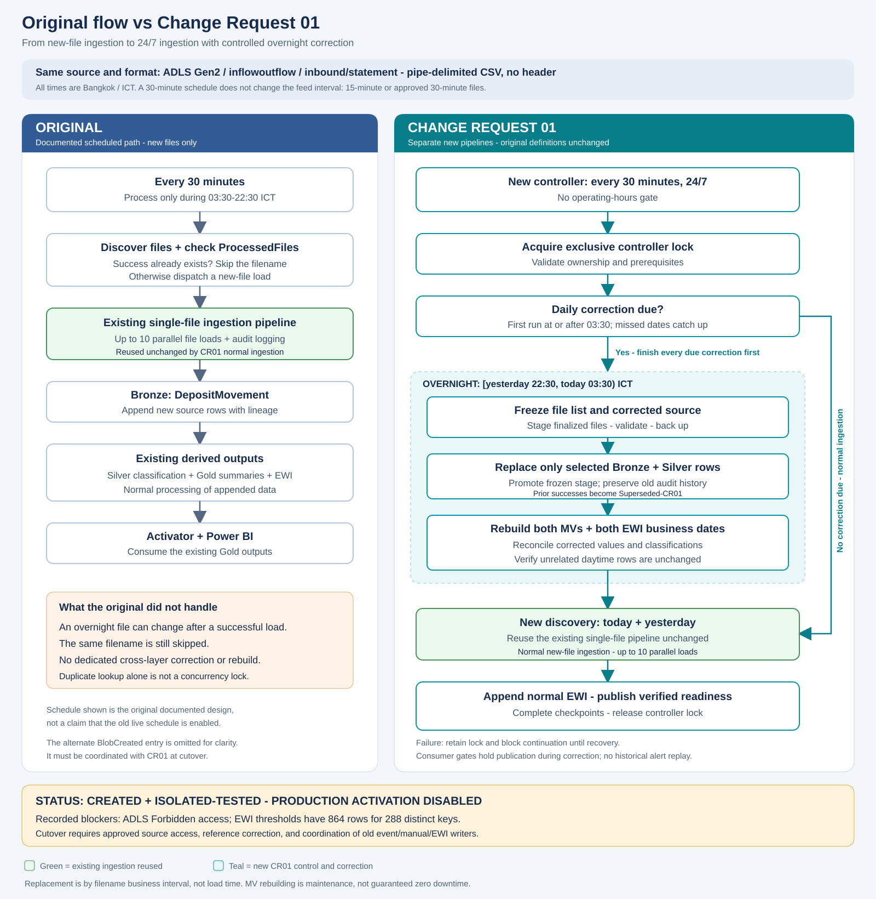

# Original Flow vs CR01

**Original:** ingest new files during the documented scheduled operating window.
**CR01:** ingest 24/7 and replace finalized overnight data once per due date.

The original side represents the [documented scheduler design](../07-interval-scheduler/README.md), not a claim that the old live schedule is enabled. The alternate BlobCreated path is omitted for clarity and must be coordinated at cutover.

## Application Architecture

The following Mermaid source is editable and renders in compatible Markdown viewers.

```mermaid
flowchart TD
    subgraph OriginalFlow["Original - documented scheduled path"]
        OrigSchedule["Every 30 minutes - 03:30 to 22:30 ICT"]
        OrigDiscover["Discover files and check successful filenames"]
        OrigSkip["Already successful - skip"]
        OrigLoad["Existing single-file ingestion pipeline"]
        OrigBronze[("Bronze - append new rows")]
        OrigDerived["Silver classification and normal Gold or EWI"]
        OrigServe["Activator and Power BI"]
        OrigSchedule --> OrigDiscover
        OrigDiscover -->|"Already successful"| OrigSkip
        OrigDiscover -->|"New file"| OrigLoad
        OrigLoad --> OrigBronze
        OrigBronze --> OrigDerived
        OrigDerived --> OrigServe
    end
    subgraph CrFlow["CR01 - new pipelines, activation disabled"]
        CrSchedule["Every 30 minutes - 24/7"]
        CrLock["Acquire exclusive lock and validate prerequisites"]
        CrDue["Any daily correction due at or after 03:30?"]
        CrStage["Freeze overnight file list - stage and validate"]
        CrBackup["Back up affected data and hold publication"]
        CrReplace["Replace selected Bronze and Silver rows"]
        CrAudit["Preserve old successful audit history"]
        CrRebuild["Rebuild both MVs and both EWI business dates"]
        CrVerify["Reconcile data - complete all due corrections"]
        CrDiscover["New discovery - today and yesterday"]
        CrLoad["Reuse existing single-file pipeline unchanged"]
        CrPublish["Append normal EWI and publish verified readiness"]
        CrRelease["Complete checkpoints and release lock"]
        CrSchedule --> CrLock
        CrLock --> CrDue
        CrDue -->|"Yes"| CrStage
        CrStage --> CrBackup
        CrBackup --> CrReplace
        CrReplace --> CrAudit
        CrAudit --> CrRebuild
        CrRebuild --> CrVerify
        CrVerify --> CrDiscover
        CrDue -->|"No"| CrDiscover
        CrDiscover --> CrLoad
        CrLoad --> CrPublish
        CrPublish --> CrRelease
    end
```

<!-- mermaid-checked: no \n, no em-dash/en-dash, no {} in labels, subgraphs are id["label"], arrows are -->|"label"|, all subgraphs closed by end, ids unique -->

### Technology Stack Summary

| Layer | Technology | Version | Purpose |
| --- | --- | --- | --- |
| Source | ADLS Gen2 | Managed service | Pipe-delimited, no-header CSV files |
| Orchestration | Fabric Data Factory pipelines | Managed service | Discovery, ingestion, correction, and serialization |
| Data and classification | Fabric Eventhouse / KQL | Managed service | Bronze, Silver, staging, backups, and MVs |
| Audit and checkpoints | Fabric Warehouse / SQL | Managed service | Successful loads, superseded history, frozen manifests, and due-date state |
| Serving | Activator and Power BI | Managed service | Alerts, digests, and dashboards |

### Data Storage and External Services

The source storage and production Bronze/Silver tables remain the same. Normal CR01 ingestion invokes the existing single-file child. Correction uses new staging/backup objects and dedicated control tables; it does not depend on reloading an already-successful file through the old duplicate-skipping path.

### Key Architectural Decisions

- Replace business intervals **[yesterday 22:30, today 03:30)**, identified by filenames, not ingestion timestamps. Stage finalized source before deleting selected rows.
- Serialize controller runs and require competing old/manual/EWI writers to be coordinated at cutover. Failure retains the lock instead of continuing with partially corrected results.
- Repair all affected derived outputs; consumer gates hold readiness during maintenance. Dropping/rebuilding MVs is not guaranteed zero downtime.

## Component Relationships

This second diagram expands only the CR01 correction branch. All due correction dates finish before normal discovery resumes.

```mermaid
flowchart LR
    subgraph CorrectionControl["New CR01 correction control"]
        DetailController["24/7 controller with exclusive owner lock"]
        DetailManifest["Frozen date and exact filename manifest"]
        DetailStage[("Validated corrected staging snapshot")]
        DetailBackup[("Scoped backups and unrelated-row fingerprints")]
    end
    subgraph CorrectionData["Controlled replacement"]
        DetailBronze[("Replace selected Bronze rows")]
        DetailSilver[("Replace and regenerate selected Silver rows")]
        DetailAudit["Archive and supersede prior success entries"]
    end
    subgraph CorrectionOutputs["Derived data and publication"]
        DetailMvs["Rebuild Bronze summary and Silver base MVs"]
        DetailEwi["Recalculate stored EWI for both complete dates"]
        DetailChecks["Verify values, grain, health and unchanged rows"]
        DetailResume["Commit refresh - resume normal discovery"]
    end
    DetailController --> DetailManifest
    DetailManifest --> DetailStage
    DetailStage --> DetailBackup
    DetailBackup --> DetailBronze
    DetailBronze --> DetailSilver
    DetailSilver --> DetailAudit
    DetailAudit --> DetailMvs
    DetailMvs --> DetailEwi
    DetailEwi --> DetailChecks
    DetailChecks --> DetailResume
```

<!-- mermaid-checked: no \n, no em-dash/en-dash, no {} in labels, subgraphs are id["label"], arrows are -->|"label"|, all subgraphs closed by end, ids unique -->

### Component Inventory

| Component | Layer | Type | Responsibility |
| --- | --- | --- | --- |
| New 24/7 controller | Orchestration | Pipeline | Owns lock, handles missed dates, orders correction before discovery |
| New discovery | Orchestration | Pipeline | Finds new today/yesterday files; invokes the unchanged ingestion child |
| New overnight refresh | Correction | Pipeline | Stages, validates, backs up, replaces, rebuilds, and reconciles |
| Existing ingestion child | Ingestion | Reused pipeline | Loads one new file and writes normal audit results |
| CR01 control tables and gates | Operations | SQL/KQL objects | Track stages/history and control publication readiness |

## Scope and Status

- **Unchanged:** source location/CSV format, original pipeline definitions, and the single-file child used for normal ingestion.
- **Feed cadence:** the 30-minute controller supports the existing 15-minute feed or an approved 30-minute feed; it does not change file intervals.
- **Created and tested:** separate CR01 pipelines, supporting scripts, and UI documentation; isolated live validation passed.
- **Not activated:** the recorded blockers remain ADLS Forbidden and duplicate threshold reference keys, pending owner-approved remediation and cutover.

See the [Fabric UI guide](FABRIC-UI-GUIDE.md), [technical runbook](README.md), and [recorded test results](TEST-RESULTS.md).
